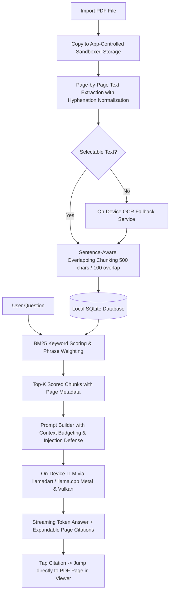

# Local PDF AI Assistant (100% On-Device AI)

A production-oriented, privacy-first Flutter mobile application for Android and iOS that allows users to import PDF documents, summarize chapters, ask complex questions, and receive AI-generated answers with source page citations using **100% on-device inference**.

> **Zero Cloud APIs. Zero Servers. Zero Data Leakage.**  
> Documents, extracted text chunks, embeddings, and inference run entirely within the user's mobile device sandbox.

---

## Architecture Overview

Built following **Clean Architecture** principles with a feature-first modular structure:

```
lib/
├── app/
│   ├── app.dart            # MultiRepositoryProvider & MultiBlocProvider root
│   ├── router.dart         # Declarative routing
│   └── theme/
│       ├── app_colors.dart # Curated palette (Slate, Indigo, Cyan, Emerald)
│       └── app_theme.dart  # Material 3 light and dark theme configurations
├── core/
│   ├── constants/
│   │   ├── app_constants.dart  # RAG defaults, token budgets, limits
│   │   └── model_registry.dart # Curated mobile GGUF models metadata
│   ├── database/
│   │   ├── database_service.dart # SQLite lifecycle and migrations
│   │   └── tables.dart           # Schema definitions and column constants
│   ├── errors/
│   │   ├── exceptions.dart # Low-level data exceptions
│   │   └── failures.dart   # Domain failure contracts
│   ├── storage/
│   │   └── storage_management_service.dart # Sandboxed storage & disk usage stats
│   ├── utils/
│   │   ├── text_normalizer.dart # Hyphenation repair, whitespace collapse
│   │   └── token_estimator.dart # Context budget headroom calculations
│   └── widgets/
│       ├── empty_state_view.dart # Helpful empty states
│       ├── error_banner.dart     # Inline dismissible errors
│       ├── glass_card.dart       # Modern rounded card design
│       ├── loading_skeleton.dart # Shimmering loading placeholders
│       └── status_badge.dart     # Semantic state badges
└── features/
    ├── dashboard/          # Home dashboard, storage stats, recent files
    ├── documents/          # Document picker, PDF extractor, chunking & preview
    ├── document_chat/      # RAG pipeline, BM25 retrieval, grounded Q&A, citations
    ├── model_manager/      # GGUF download with cancellation, RAM lifecycle
    ├── settings/           # Temperature, max tokens, theme, data purging
    └── summarization/      # Map-Reduce multi-section document summarization
```

---

## Curated On-Device GGUF Models

| Model | Format | Quantization | Disk Size | Min RAM | Context Length | License | Recommended For |
|---|---|---|---|---|---|---|---|
| **Qwen 2.5 0.5B Instruct** | GGUF | Q4_K_M | ~380 MB | 700 MB | 2,048 tokens | Apache-2.0 | Standard Android & iOS devices (Default) |
| **SmolLM2 360M Instruct** | GGUF | Q4_K_M | ~230 MB | 450 MB | 2,048 tokens | Apache-2.0 | Budget phones, instant loading |
| **Llama 3.2 1B Instruct** | GGUF | Q4_K_M | ~843 MB | 1,400 MB | 4,096 tokens | Llama 3.2 Community | Mid-range to flagship phones |

---

## On-Device RAG Pipeline



### Prompt Injection Defense
PDF documents often contain untrusted external text. The `PromptBuilderService` treats all extracted text as untrusted data wrapped in `<document_context>` delimiters and injects explicit system instructions instructing the local model never to follow instructions or commands contained inside document excerpts.

---

## Native Platform Setup

### Android Setup
- **Minimum SDK**: `24` (Android 7.0 Nougat) configured in `android/app/build.gradle.kts`.
- **Permissions**: `android.permission.INTERNET` declared for optional GGUF model download from HuggingFace. No camera, location, or contacts permissions required.
- **Hardware Acceleration**: Automatically selects Vulkan on compatible Adreno/Mali GPUs or high-performance multithreaded ARM64 CPU.

### iOS Setup
- **Deployment Target**: iOS `16.4` configured in `ios/Podfile` and Runner build settings.
- **Companion Package**: `llamadart_llama_cpp_flutter: ^0.0.22` links native Apple XCFrameworks via Swift Package Manager with Metal GPU acceleration.
- **Privacy & Storage**: `LSSupportsOpeningDocumentsInPlace` and `UIFileSharingEnabled` enabled in `ios/Runner/Info.plist`.

---

## Testing & Verification

Run the complete automated test suite (24 unit and widget tests):

```bash
flutter test
```

### Static Analysis

```bash
flutter analyze
```

### Airplane Mode / Offline Verification Checklist
1. Launch the application with an internet connection.
2. Open **Model Manager** and download the recommended **Qwen 2.5 0.5B Instruct** (~380 MB).
3. Tap **Load to RAM**.
4. Enable **Airplane Mode** on the physical phone (disable both Wi-Fi and Cellular).
5. Tap **Import PDF** and choose any PDF file.
6. Observe text extraction, chunking, and database indexing.
7. Open **Chat with AI** and ask questions (e.g., *"Summarize this document"*, *"What are the key findings?"*).
8. Verify that streaming tokens, answers, and page citations appear 100% offline.
9. Open **Settings** and verify that no network requests are attempted.
